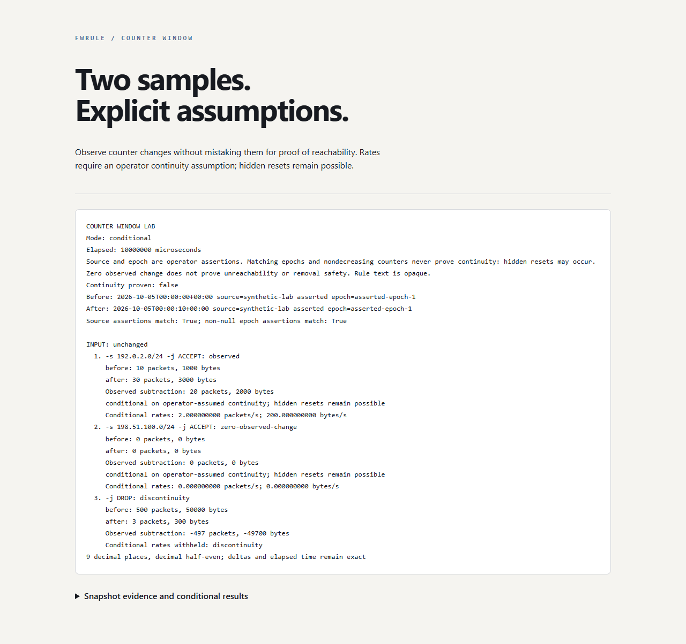

# Firewall counter window lab

An offline learning tool for comparing two synthetic firewall counter snapshots.
It exposes observations, rule identity gaps and continuity assumptions. It never
collects live counters or changes firewall rules. Python 3.13+; standard library
only at runtime. Original project, MIT licensed, developed with AI assistance.



## Try it

From this directory:

```powershell
python -m counter_window samples/before.json samples/after.json
python -m counter_window samples/before.json samples/after.json --format json
python -m counter_window samples/before.json samples/after.json --assume-continuity --format html --output my-report.html
python -m unittest discover -v
python scripts/demo_reports.py --check
```

The supplied pair deliberately includes a decreasing counter, so successful
report generation returns **3** (incomplete evidence). Exit **0** means valid
observations, or all requested conditional estimates available. It does not
certify continuity, rule reachability or firewall safety. Exit **2** means invalid
input/window or an I/O/argument error. Existing output files are never overwritten.

Open `samples/counter-window.html` for the static demonstration. There are no
scripts, remote assets or server requirements. Every report retains the hidden
reset and zero-counter limitations. Terminal/HTML reveal non-ASCII code points
with backslash escapes; JSON retains their original values using escaped encoding.

## What the numbers mean

The example's first rule moves from 10 to 30 packets over 10 seconds: observed
subtraction is 20. With `--assume-continuity`, its **conditional** rate is 2 packets
per second. The unchanged zero-count rule still cannot be declared unreachable.
The third rule decreases from 500 to 3: the tool calls this discontinuity and
withholds rates, without guessing a reset or wrap.

Even 10 followed by 30 could hide a reset to zero and 30 later packets. Matching
source and epoch identifiers are operator assertions, not authenticated evidence.
They never prove that counters were continuous. The default performs subtraction
only, with no inferred traffic rates; the flag expresses an assumption.

An unchanged *whole ordered chain*, including policy and exact opaque rule text,
is required for pairing. Changed text, reordered/added/removed rules and source
mismatch retain unpaired evidence. Duplicate rule texts are ambiguous even when
their positions match; missing counters stay unknown. Either counter decreasing
withholds both conditional rates. Rule text has no evaluated firewall semantics.
Different chains are independent; the envelope's chain-list order is irrelevant.

## Contract and architecture

[Schema](docs/SCHEMA.md) defines the strict versioned JSON format. Input is not
`iptables-save`, native nftables or a live exporter. A converter or collector is
outside this version's scope. `epoch_id` is required as a field but may be null.

```text
bounded files → strict JSON/schema → immutable snapshots
             → whole-chain identity → observations / conditional estimates
             → terminal, JSON, inert HTML
```

The parser caps input at 2 MiB, nesting at 8, numeric text at 20 characters,
records/chains at 1,000 and rule text at 8,192 characters. Unknown fields,
duplicate keys, booleans in integer fields, floating/nonfinite numbers, invalid
timestamps and duplicate chain identifiers are rejected. Exact elapsed
microseconds must be positive. Rates use decimal half-even rounding to 9 places;
integer subtractions and elapsed time remain exact.

Public interfaces: `parse_snapshot(bytes)` and `load_snapshot(Path)` return
validated `Snapshot` objects or raise `InputError` (file I/O also raises `OSError`).
`compare(before, after, assume_continuity=False)` expects validated snapshots and
returns report version 1. `render(report, format)` expects that internal report.

## Security, evidence and learning

[Security model](SECURITY.md), [review](REVIEW.md) and
[verification](VALIDATION.md) describe tested facts and remaining limits.
Use synthetic records for portfolio artifacts. Real rule records can reveal
network topology and must remain private; local report writing is not encryption.
Manual review is required before consequential reliance.

`scripts/demo_reports.py` is the reusable evidence generator: no path arguments,
six fixed synthetic outputs under `samples/`, byte-for-byte `--check` verification.
Write mode intentionally overwrites those six demo artifacts; the CLI remains
exclusive. [Research/approved plan](docs/PLAN.md) records sources, alternatives,
licensing and the coordinator approval gate. [Decisions](DECISIONS.md) and
[learning](LEARNING.md) capture why the lab is deliberately conservative.

CI preparation pins actions to immutable SHAs verified against upstream on
October 5, 2026 in the predecessor fwrule workstream. Tests/Bandit and weekly
CodeQL are configured for a future `main` branch; Dependabot is prepared. Hosted
eligibility, branch protection, secret scanning and actual CI are not verified:
this repository has no remote and has not been published.

No upstream implementation was copied. Research references include
[retailnext/iptables_exporter](https://github.com/retailnext/iptables_exporter),
[brb/iptables-diff](https://github.com/brb/iptables-diff) and official
[Prometheus counter documentation](https://prometheus.io/docs/prometheus/latest/querying/functions/).
Sources informed scope and limitations, not a claim that this tool reproduces
Prometheus reset adjustment or extrapolation. Codex implemented and reviewed the
code; local qwen3.5:2b supplied bounded learning prose reviewed and corrected by
Codex. No remote drafting or third-party runtime dependencies were used.

Optional exercise: invent two different histories that produce the same pair
of visible packet counters. Which assumption would distinguish them?

## Publication status

See [publication review](PUBLICATION.md) for the October 5 source snapshot, fresh local checks, evidence boundaries and current hosted-check distinction.
